


<a href="https://github.com/HisokaDrip/pure-python-deflate">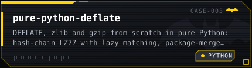</a>
<a href="https://github.com/HisokaDrip/derwick">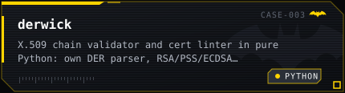</a>
<a href="https://github.com/HisokaDrip/pddl-planner">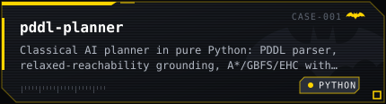</a>
<a href="https://github.com/HisokaDrip/skein">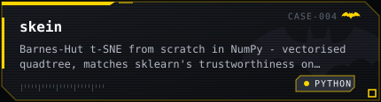</a>
<a href="https://github.com/HisokaDrip/git-from-scratch">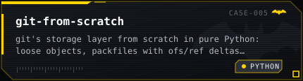</a>

<a href="https://github.com/HisokaDrip/cfr-poker-solver">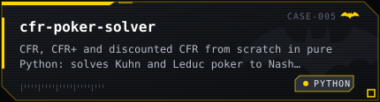</a>
<a href="https://github.com/HisokaDrip/brume">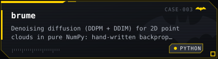</a>
<a href="https://github.com/HisokaDrip/taintline">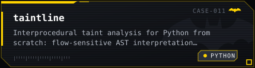</a>
<a href="https://github.com/HisokaDrip/tiny-sql-engine">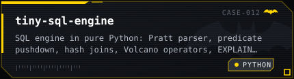</a>
<a href="https://github.com/HisokaDrip/kriga">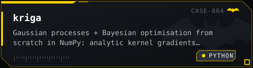</a>
<a href="https://github.com/HisokaDrip/monte-carlo-localization">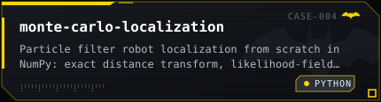</a>


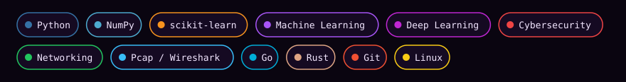

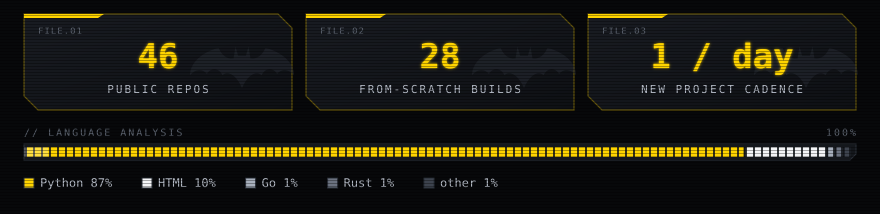



<a href="https://github.com/HisokaDrip/veritree">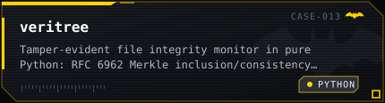</a>
<a href="https://github.com/HisokaDrip/raft-kv-simulator">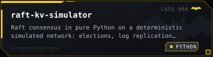</a>
<a href="https://github.com/HisokaDrip/tinyboost">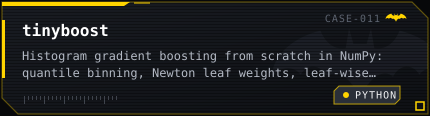</a>
<a href="https://github.com/HisokaDrip/neat-neuroevolution">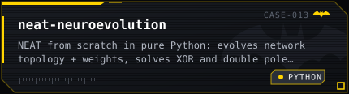</a>
<a href="https://github.com/HisokaDrip/stegora">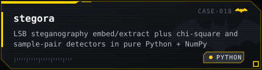</a>
<a href="https://github.com/HisokaDrip/thompson-regex-engine">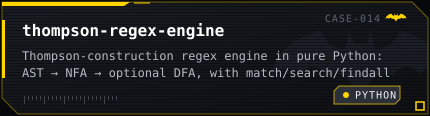</a>
<a href="https://github.com/HisokaDrip/glyphnet">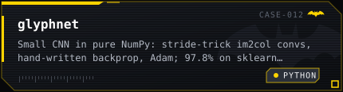</a>
<a href="https://github.com/HisokaDrip/cdcl-sat-solver">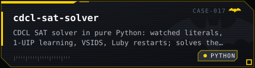</a>

<a href="https://github.com/HisokaDrip/password-strength-estimator">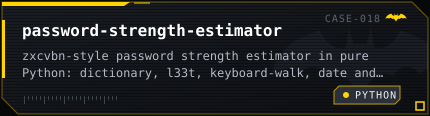</a>
<a href="https://github.com/HisokaDrip/isoscope">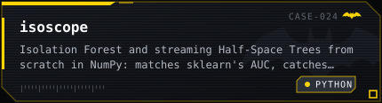</a>
<a href="https://github.com/HisokaDrip/tetrad">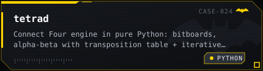</a>
<a href="https://github.com/HisokaDrip/lsm-kv-store">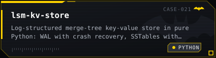</a>
<a href="https://github.com/HisokaDrip/serpent-q">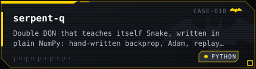</a>
<a href="https://github.com/HisokaDrip/pcapsleuth">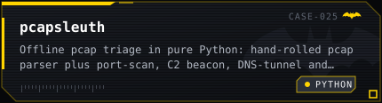</a>
<a href="https://github.com/HisokaDrip/lumen-rt">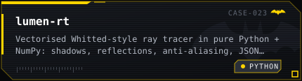</a>
<a href="https://github.com/HisokaDrip/ndgrad">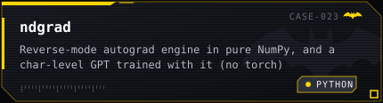</a>

<a href="https://github.com/HisokaDrip/cart-tree-from-scratch">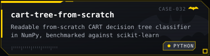</a>
<a href="https://github.com/HisokaDrip/side-projects">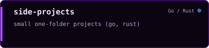</a>
<a href="https://github.com/HisokaDrip/leetcode-solutions">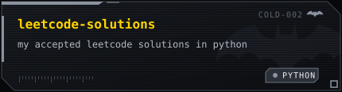</a>
<a href="https://github.com/HisokaDrip/TourismAi">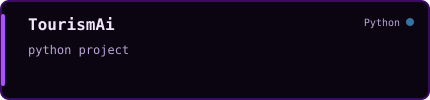</a>
<a href="https://github.com/HisokaDrip/The-Bridge">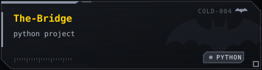</a>
<a href="https://github.com/HisokaDrip/Ai-Scavenger-Hunt"></a>
<a href="https://github.com/HisokaDrip/ML-Mini-Project"></a>
<a href="https://github.com/HisokaDrip/Algorithm-Lab"></a>

