


<a href="https://github.com/HisokaDrip/isoscope">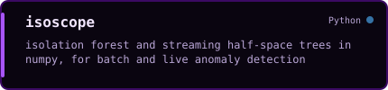</a>
<a href="https://github.com/HisokaDrip/tetrad"></a>
<a href="https://github.com/HisokaDrip/lsm-kv-store"></a>
<a href="https://github.com/HisokaDrip/pcapsleuth">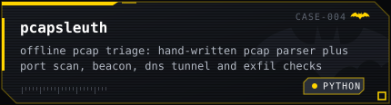</a>
<a href="https://github.com/HisokaDrip/lumen-rt">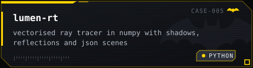</a>
<a href="https://github.com/HisokaDrip/ndgrad"></a>
<a href="https://github.com/HisokaDrip/cart-tree-from-scratch"></a>
<a href="https://github.com/HisokaDrip/siftrank">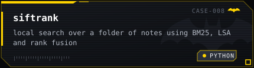</a>
<a href="https://github.com/HisokaDrip/password-strength-estimator">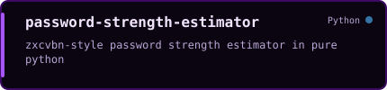</a>
<a href="https://github.com/HisokaDrip/serpent-q"></a>
<a href="https://github.com/HisokaDrip/pyara">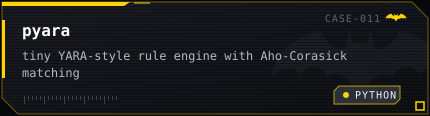</a>


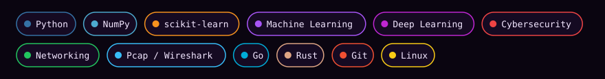

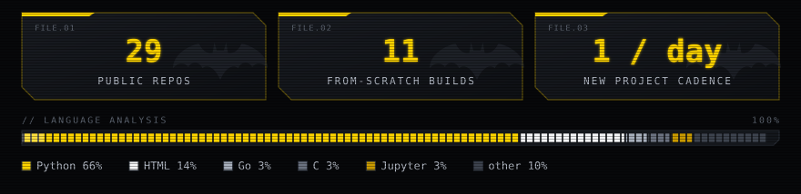



<a href="https://github.com/HisokaDrip/side-projects">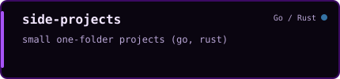</a>
<a href="https://github.com/HisokaDrip/leetcode-solutions">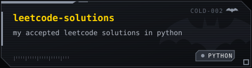</a>
<a href="https://github.com/HisokaDrip/TourismAi">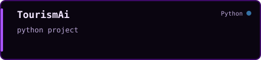</a>
<a href="https://github.com/HisokaDrip/The-Bridge">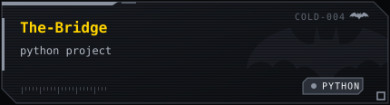</a>
<a href="https://github.com/HisokaDrip/Ai-Scavenger-Hunt"></a>
<a href="https://github.com/HisokaDrip/ML-Mini-Project"></a>
<a href="https://github.com/HisokaDrip/Algorithm-Lab"></a>

